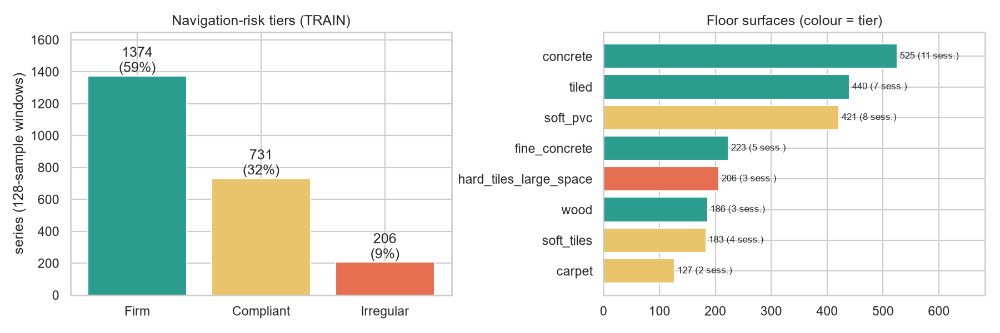
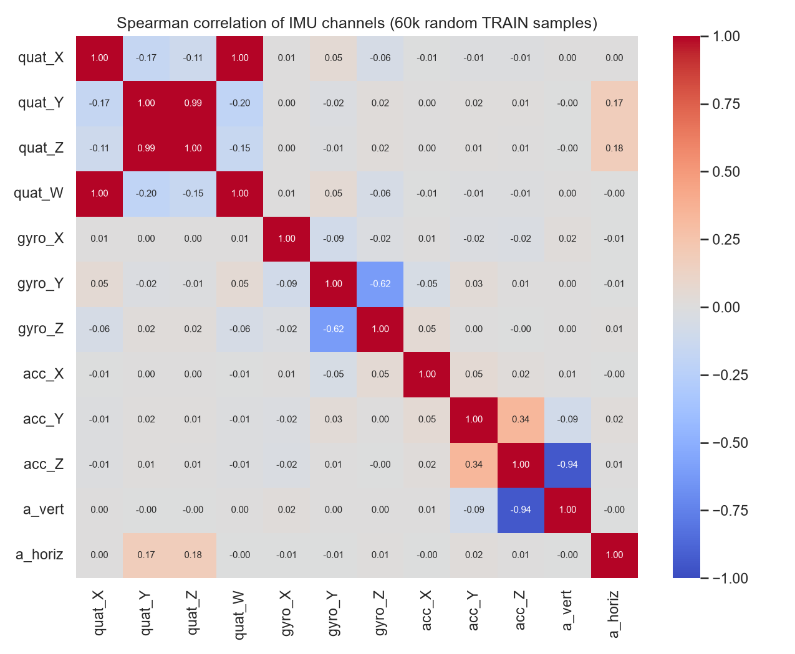
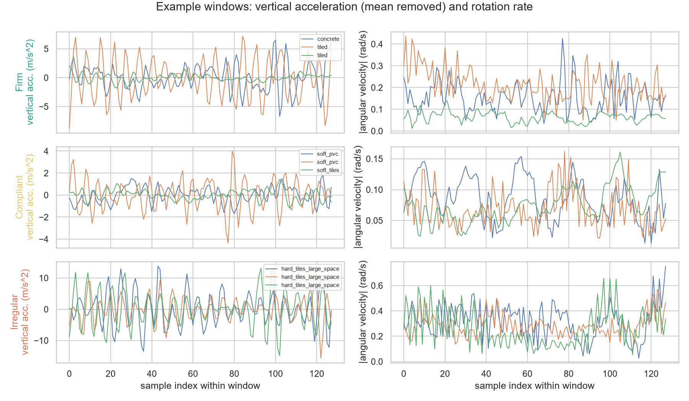
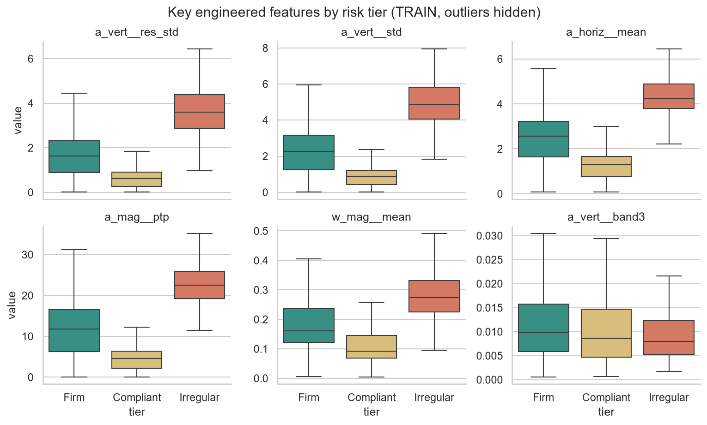
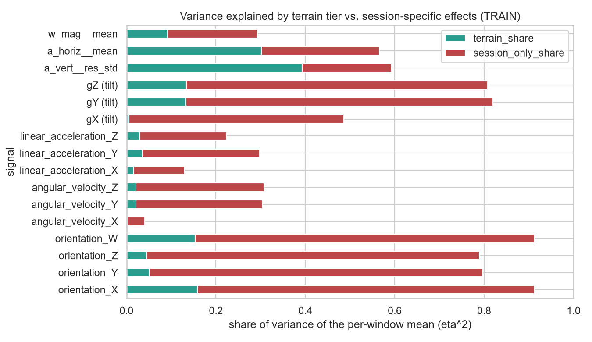
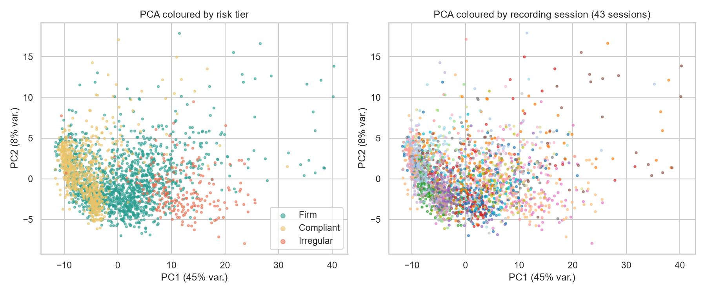
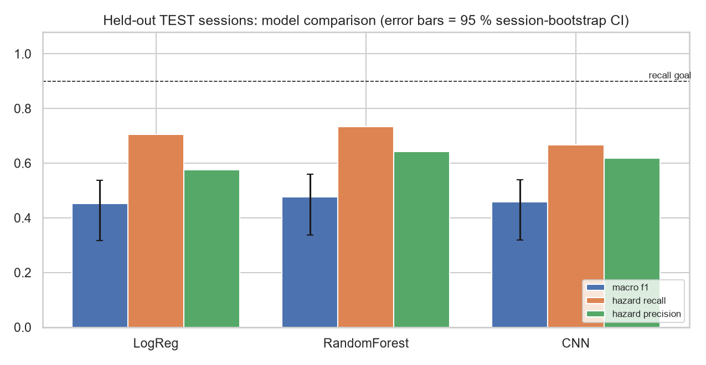
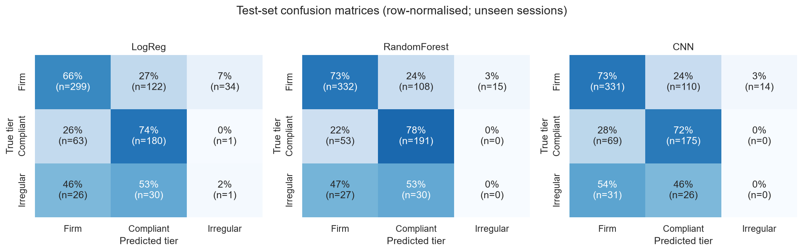
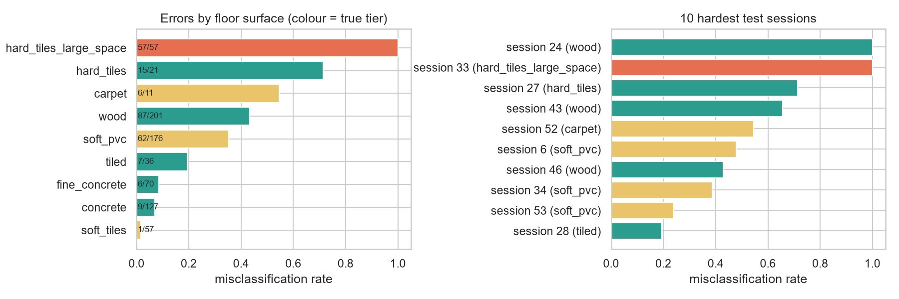

# Terrain-Risk Classification for Autonomous Rovers from IMU Time Series

*Project report (presentation + viva). All numbers below were produced by `python run_pipeline.py` (seed 42, CPU, library versions in `requirements-tested.txt`). The same run repeated twice gave identical metrics (maximum difference 0.0). Machine-written tables are in `outputs/results/results_summary.md`; figures are in `outputs/figures/`.*

---

## 0. Executive summary (read this first)

| | |
|---|---|
| **Question** | Can a rover tell from 128 IMU samples whether the floor ahead needs speed/torque adaptation (hazardous) or not, **on a recording session it has never seen**? |
| **Data** | Kaggle *CareerCon 2019, Help Navigate Robots*: 3,810 windows × 128 steps × 10 IMU channels, 73 recording sessions, 9 floor surfaces |
| **Models** | Logistic Regression (baseline), Random Forest, PyTorch 1D-CNN (7,299 parameters), plus a majority-class reference |
| **Protocol** | Split by *session*, never by window (60/20/20 = 43/15/15 sessions); tuning with grouped CV on train sessions; test touched once |
| **Result** | All three models beat the majority baseline (test macro-F1 0.45 to 0.48 vs 0.25) but **none reaches the goals fixed in advance** (macro-F1 ≥ 0.80, hazard recall ≥ 0.90). Best test hazard recall with the plain rule: 0.78 (CNN). |
| **Most informative findings** | (1) Random folds inflate macro-F1 from 0.65 to 0.87 when raw orientation is used, so session-level splitting is essential. (2) The rare *Irregular* tier was essentially never recognised on the held-out session (recall 0 to 0.02). (3) Most errors come from a few sessions, mainly *wood* floors that "feel" like soft floors to an IMU. |
| **Honest verdict** | A leakage-aware benchmark and a diagnosis of why the task is hard, **not** a deployable stall-prevention system. |

---

## 1. Problem and Data

### 1.1 Problem statement

An autonomous rover should adapt speed and motor torque to the surface under its wheels. Driving at full speed over a compliant surface (carpet, soft PVC) risks wheel sinkage, slip and **stalling**; driving over joints/gaps risks **jolts and loss of traction**. The task: classify each 128-sample IMU window into a navigation-risk tier.

| Tier | Floor surfaces in the dataset | Physical rationale (an assumption, see 1.4) | Action |
|---|---|---|---|
| 0 **Firm** | concrete, fine_concrete, tiled, hard_tiles, wood | low rolling resistance | full speed |
| 1 **Compliant** | carpet, soft_pvc, soft_tiles | wheel sinkage, slip, higher drag: stall risk | raise torque, slow down |
| 2 **Irregular** | hard_tiles_large_space | joints/gaps: jolts, traction loss | slow down, damp |

*Hazardous* = tier 1 or 2. All assumptions are in `config.py` (`SURFACE_TO_TIER`) and can be edited.

### 1.2 Measurable goals (fixed before any experiment, `config.GOALS`)

| Goal | Threshold | Why |
|---|---|---|
| G1 Hazard recall on unseen test sessions | ≥ 0.90 | a missed hazard is the costly error |
| G2 Macro-F1 on unseen test sessions | ≥ 0.80 | balanced quality over three imbalanced tiers |
| G3 Beat the majority-class reference | clearly | sanity check |

### 1.3 Loading the dataset (`data.py`)

```python
import data as D
X_raw, y_raw = D.load_raw()          # downloads X_train.csv / y_train.csv once, verifies SHA-256
cube, meta, audit = D.validate_and_clean(X_raw, y_raw)   # cube: (3810, 128, 10) float32
```

### 1.4 Dataset justification

The data is the public Kaggle competition *CareerCon 2019 – Help Navigate Robots* (competition slug `career-con-2019`): IMU recordings from a mobile robot driving over nine indoor floor types. It contains **487,680 rows = 3,810 labelled series × 128 consecutive samples**, each with 10 channels (orientation quaternion ×4, angular velocity ×3, linear acceleration ×3), plus a `group_id` that identifies the **73 recording sessions**. It is real sensor data with real noise, spikes and session effects, so it is not a toy dataset. I chose it because it is openly downloadable, its IMU windows are labelled by the surface the robot is driving on, and it ships session identifiers, which are essential for leakage-free evaluation. KITTI and nuScenes were considered but are driving datasets without terrain-stability labels. **Limits of this choice:** the surfaces are indoor floors, not off-road terrain; there is no depth data and no recorded stall events (so risk tiers are a proxy); I did not find the sampling rate or robot platform documented in the sources I checked; the files come from a third-party GitHub mirror (hash-verified), so cite the Kaggle competition and check its terms before redistributing.



---

## 2. Data Preparation and EDA

### 2.1 Cleaning audit (`data.validate_and_clean`) and the reasoning behind each choice

| Check | Finding | Decision and reasoning |
|---|---|---|
| Data types | 10 float64 channels, int ids, text label | channels → `float32` (half the memory, far finer than IMU resolution); ids → `int32`; label → lowercase string |
| Missing values | 0 | code still interpolates gaps *inside one series only* (no information crosses series) and drops windows with > 10 % gaps |
| Duplicate rows / keys / whole series | 0 / 0 / 0 | code drops repeats anyway: a duplicated window across splits would leak |
| Window completeness | all 3,810 have exactly 128 steps | enforced, so a (N,128,10) tensor is valid |
| Quaternion norm | 0.99999 to 1.00001 | renormalise only if off by > 1e-3 (none were) |
| One surface per session | 0 sessions violate this | confirms `group_id` is a clean grouping key |
| **Outliers** (robust z > 6) | gyro 0.15 to 2.3 %, accel 0.6 to 3.0 % of samples; extremes down to −121 m/s² (acc-Y) | **kept, not deleted**: a window must keep its 128 steps, and a spike on tile joints is the signal. Treatment = winsorising with bounds **fitted on train only** (`Winsorizer` for features, `SequenceScaler` for the CNN). Features use robust statistics (spike fraction, MAD-based) |

*Honest note:* the dataset arrived clean, so the missing-value and duplicate branches are defensive code that was exercised only as checks, not as repairs.

### 2.2 Feature engineering (`features.py`, 149 features per window)

| Idea | Implementation | Physical meaning |
|---|---|---|
| **Gravity direction instead of raw orientation** | rotate world-up into the sensor frame (3rd row of the rotation matrix) → `gX, gY, gZ` | tilt without heading; raw quaternions encode which way the robot faced (a session fingerprint, see Plot 5) |
| **Vertical / horizontal acceleration** | `a_vert = a · g_up` (mean ≈ 9.8 m/s², confirming the projection), `a_horiz = √(|a|² − a_vert²)` | vertical = vibration/bumps; horizontal = traction, drag, slip |
| **Rolling-mean spike features** | residual = signal − centred rolling mean (window 5); `res_std`, `res_maxabs`, `spike_frac` (> 3 robust σ) | isolates impacts from the slow motion of the robot |
| Statistics per signal | mean, std, min, max, range, skew, kurtosis, mean |Δx| (jerk proxy) | amplitude and impulsiveness |
| Spectral | 4 normalised band-power fractions, dominant frequency, spectral entropy for `a_vert, a_horiz, wX, wY, wZ` | texture/periodicity (normalised because the sampling rate is undocumented) |
| Cross-axis coupling | corr(`a_vert`,`wX`), corr(`a_vert`,`wY`), corr(`aX`,`aY`) | bump ↔ pitch/roll coupling |

The CNN instead receives the 11 raw-derived channels (`wX,wY,wZ,aX,aY,aZ,gX,gY,gZ,a_vert,a_horiz`) as a (11 × 128) sequence.

### 2.3 EDA plots (train sessions only, so test statistics never guide design)

**Plot 1: class balance** (above). Train windows: Firm 1,374 (59 %), Compliant 731 (32 %), Irregular 206 (9 %) from 26/14/3 sessions. *Insight:* the dangerous Irregular tier is both rare and backed by only three sessions, so macro-F1 and recall (not accuracy) are the right yardsticks, and any Irregular estimate will be fragile.



**Plot 2: Spearman correlation heatmap.** Quaternion components are almost redundant (X–W ρ = 0.996, Y–Z ρ = 0.995), so they carry little independent information. Raw acc-Z vs `a_vert` is ρ = −0.94: the sensor's Z axis points roughly downward (mean acc-Z ≈ −9.4 m/s²), which is exactly why the gravity projection is needed. Gyro-Y and gyro-Z are coupled (ρ = −0.62), consistent with rocking motion that mixes pitch and yaw. *Insight:* raw channels are entangled with mounting/orientation; derived physical signals are cleaner.



**Plot 3: example windows per tier.** Vertical acceleration of Compliant windows stays within a few m/s² (soft floors damp shocks), Irregular windows show large, strongly periodic swings of ±10 to 15 m/s² (impacts at joints), and Firm windows range from calm to strongly oscillating (some `tiled` windows swing by about ±8). *Insight:* vibration amplitude and periodicity are the physical cues; the overlap of Firm with both others foreshadows the confusions in Section 4.



**Plot 4: feature distributions by tier.** Medians of vibration features are ordered Irregular > Firm > Compliant: `a_vert__res_std` 3.61 / 1.63 / 0.62 m/s², `a_mag__ptp` 22.5 / 11.8 / 4.6, `w_mag__mean` 0.274 / 0.160 / 0.092 rad/s. The Firm interquartile range (e.g. 1.43 on `a_vert__res_std`) is wide, so overlap is large. *Insight:* the physics behind the tiers is real, but an IMU measures *dynamics*, not material stiffness.



**Plot 5: terrain vs session variance (η²).** For the per-window mean of orientation_X, 16 % of variance is explained by tier but a further **75 % only by session**; the same holds for orientation_Y/Z/W (session-only share 0.74 to 0.76). Gyro/acc channels are far less session-bound (session-only 0.04 to 0.29). Engineered `a_vert__res_std` has the largest terrain share (0.39). Gravity-tilt means are still partly session-specific (session-only 0.48 for gX, 0.67 to 0.69 for gY, gZ). *Insight:* this is why raw orientation was dropped, and it flags that tilt features only partly remove the session fingerprint.



**Plot 6: PCA of the features.** PC1 (45 % of variance) roughly orders windows by vibration intensity: Compliant sits at low PC1, Irregular at high PC1, Firm spreads across both; the right panel shows sessions interleaved rather than cleanly separated. *Insight:* tiers overlap heavily in feature space, so a linear separation will be limited.

---

## 3. Modelling and Analysis

### 3.1 Leakage-free protocol

1. **Split by session** (`data.make_group_splits`): stratified-group splitting on `group_id`, 60/20/20, with `assert` that no session appears in two splits. Series from one session are consecutive slices of one drive; shuffling them across splits lets a model recognise the *session*.
2. **Test set locked** until the final evaluation.
3. **Every fitted step is fitted on train only:** winsorising, scaling and class weights live inside sklearn `Pipeline`s / CV folds / the CNN training function.
4. **EDA on train only.** Window features are computed per window (no cross-window statistics), so computing them once is leak-free.

| Split | Windows | Sessions | Firm / Compliant / Irregular windows | Sessions per tier |
|---|---|---|---|---|
| Train | 2,311 | 43 | 1,374 / 731 / 206 | 26 / 14 / 3 |
| Validation | 743 | 15 | 455 / 243 / 45 | 9 / 5 / 1 |
| Test | 756 | 15 | 455 / 244 / 57 | 9 / 5 / 1 |

A split is accepted only if every tier is present in val and test and train keeps ≥ 3 sessions per tier (needed for 3-fold grouped CV). The loop only reshuffles with a deterministic seed and never looks at model performance (the first seed was accepted).

### 3.2 Models and why

| Model | Input | Why this model |
|---|---|---|
| Majority class | none | zero-skill reference |
| **Logistic Regression** (baseline) | 149 features, winsorise → standardise, L2, balanced class weights | simple, convex, interpretable; shows how far linear features go |
| **Random Forest** | 149 features, balanced-subsample class weights | handles non-linear interactions and heavy-tailed features without scaling; robust with small data |
| **PyTorch 1D-CNN** | 11 × 128 raw-derived sequence, per-channel winsorise + z-score | learns local temporal patterns (impacts, periodicity) that summary statistics may blur; 3 × (Conv1d-BN-ReLU), global average + max pooling, dropout, linear head; class-weighted cross-entropy, AdamW, cosine LR, gradient clipping, Gaussian-noise augmentation; **7,299 parameters** (small on purpose, 2.3k training windows) |

### 3.3 Cross-validation and hyper-parameter tuning

* **Method:** stratified **group** 3-fold CV on the 43 train sessions (`data.grouped_cv_folds`), each fold containing all three tiers; selection metric macro-F1, hazard recall logged alongside. Grouping matters: ordinary k-fold would let a session sit in both the training and the validation part.
* **Search:** Logistic Regression: exhaustive grid over `C` (5 values). Random Forest: 12 random draws over trees, depth, leaf size, `max_features` (random search is efficient for a 4-dimensional space). CNN: exhaustive grid of 8 (width × dropout × learning rate); CNN CV uses a *fixed* 30-epoch budget (no early stopping on the fold's validation part), so the CV estimate is not biased by checkpoint peeking.

| Model | Best setting | CV macro-F1 (mean ± std over folds) | CV hazard recall |
|---|---|---|---|
| Logistic Regression | `C = 0.1` | 0.669 ± 0.046 | 0.780 |
| Random Forest | 200 trees, `max_depth = 8`, `min_samples_leaf = 3`, `max_features = 0.2` | 0.697 ± 0.073 | 0.729 |
| CNN | width 16, dropout 0.5, lr 3e-3 | 0.675 ± 0.045 | 0.704 |

Differences between models in CV are smaller than the fold-to-fold standard deviation: they are statistically indistinguishable. Strong regularisation won where it was on offer (depth 8 was the shallowest tree option, the highest dropout and the smaller CNN width were chosen), which is consistent with session-level overfitting.

* **Final fitting:** all models are trained on the train sessions only. The CNN keeps the epoch with the best validation macro-F1 (epoch 18 of 30; val macro-F1 0.497). `fig07_cnn_learning_curves.png` shows training loss falling from 0.87 to 0.33 while validation loss rises from 1.13 (epoch 1) to 1.30 (epoch 30): **the CNN memorises its training sessions**.

---

## 4. Evaluation and Interpretation

### 4.1 Metrics and why (risk-based)

Positive class = *hazardous terrain* (tiers 1 and 2).

| Error | Real-world consequence | Cost |
|---|---|---|
| **False negative** (hazard called Firm) | rover keeps full speed/torque on carpet or tile gaps → stall, slip, jolt, mission loss | **high** |
| False positive (Firm called hazard) | rover slows down needlessly → time/energy lost | low, but a rover that always brakes is useless |

Hence: **hazard recall** (safety), **hazard precision** and false-alarm rate (efficiency), **F2** (recall-weighted), **macro-F1** as the headline (accuracy would reward predicting Firm, which is 60 % of windows), per-tier P/R/F1, and the *severe miss* rate (Irregular called Firm). Uncertainty: 95 % **session-level bootstrap** CIs (windows from one session are not independent).

### 4.2 Model comparison

Validation sessions (used for model selection) and held-out test sessions (used once), plain argmax rule:

| Model | Val macro-F1 | Val hazard recall | Test macro-F1 [95 % CI] | Test hazard recall [95 % CI] | Test hazard precision | Test false-alarm rate | Test balanced acc. |
|---|---|---|---|---|---|---|---|
| Majority | 0.253 | 0.000 | 0.250 [0.17, 0.31] | 0.000 | 0.000 | 0.000 | 0.333 |
| Logistic Regression | 0.469 | 0.774 | 0.452 [0.32, 0.54] | 0.704 [0.55, 0.92] | 0.576 | 0.343 | 0.471 |
| Random Forest | 0.494 | 0.799 | 0.478 [0.34, 0.56] | 0.734 [0.59, 0.87] | 0.642 | 0.270 | 0.504 |
| **CNN** (selected on val) | **0.497** | **0.865** | 0.473 [0.33, 0.56] | **0.781** [0.66, 0.91] | 0.630 | 0.303 | 0.503 |



* The CNN won validation by 0.003 macro-F1 over the Random Forest: **a tie**, decided by one validation session. On test the three models are within each other's confidence intervals.
* All models clear the majority baseline (G3), but the CIs only just exclude it.
* **G1 and G2 are not met** by any model (best hazard recall 0.78, best macro-F1 0.48).
* **Robustness over all 73 sessions** (grouped 5-fold CV, each session tested exactly once; hyper-parameters from the train-only tuning, so slightly optimistic):

| Model | Macro-F1 mean ± std over folds | Pooled macro-F1 | Hazard recall (mean) | Irregular recall (pooled) |
|---|---|---|---|---|
| Logistic Regression | 0.559 ± 0.111 | 0.570 | 0.778 | 0.503 |
| **Random Forest** | **0.627 ± 0.155** | **0.647** | 0.810 | 0.399 |
| CNN | 0.562 ± 0.114 | 0.572 | 0.762 | 0.383 |

This larger, more reliable experiment favours the Random Forest, so with hindsight the validation tie should not be over-read. Fold scores range from 0.43 to 0.78 (RF): **which sessions land in the test set changes the answer more than the choice of model.** Pooled out-of-fold, Irregular windows were recognised 38 to 50 % of the time (versus about 0 % on the single held-out test session), so "Irregular is undetectable" is too strong; "Irregular is detected unreliably, depending on the session" is what the data supports.

### 4.3 Safety-biased decision rule

Rule: predict Firm only if P(Firm) ≥ τ, with τ chosen on **validation** as the smallest τ ≥ 0.5 that reaches 95 % hazard recall.

| Model | τ | Val hazard recall | Test hazard recall | Test false-alarm rate | Test macro-F1 |
|---|---|---|---|---|---|
| Logistic Regression | 0.86 | 0.951 | **0.957** | 0.646 | 0.386 |
| Random Forest | 0.75 | 0.951 | 0.884 | 0.473 | 0.443 |
| CNN | 0.84 | 0.951 | 0.874 | 0.523 | 0.410 |

Trading recall for false alarms works (recall rises by 0.09 to 0.25), but **the target did not transfer exactly** (0.874 to 0.957 on test vs 0.951 on val), and the price is that 47 to 65 % of firm windows trigger a slowdown. Even the best case (LogReg, 0.957) meets G1 only by braking on two thirds of firm floor. G1 and G2 therefore cannot both be satisfied by these models.

### 4.4 Error analysis (selected CNN, test sessions)




* **241 of 756 windows (32 %) are wrong.** By type: Firm→Compliant 121 (harmless over-caution), Compliant→Firm **45 (dangerous)**, Irregular→Compliant 36, Irregular→Firm **21 (dangerous)**, Firm→Irregular 17. Hazard misses = 66 of 301 hazardous windows = 21.9 %.
* **Errors are concentrated in a few sessions:** the 3 worst sessions account for 58 % of errors, the worst 5 for 72 %. Session 33 (`hard_tiles_large_space`) is 57/57 wrong; two `wood` sessions (43 and 46) contribute 53/70 and 30/70 errors; `hard_tiles` (one session of 21 windows, absent from train) is 15/21 wrong.
* **By surface:** `soft_tiles` (2 % error) and `carpet` (0 %, but only 11 windows) are easy; `concrete` 9 %, `fine_concrete` 13 %, `soft_pvc` 26 %, `tiled` 28 %, `wood` 46 %.
* **Why wood fails (physical diagnosis):** 88 of 92 wood errors are predicted Compliant. The misclassified Firm→Compliant windows have a median peak rotation rate `w_mag__max` of 0.185 rad/s, against 0.424 for correctly classified Firm windows and 0.165 for Compliant ones: they *look like soft floors to the IMU* (smooth, low jerk). An IMU senses vibration, not stiffness, so grouping materials by stiffness is the weak link of the label design. A second contributor is the split: it is stratified by tier, so `wood` ended up with 3 train sessions but 9 in val+test.
* **Calibration:** mean confidence is 0.83 on correct and 0.77 on wrong predictions, so the model is almost as sure when wrong; confidence cannot flag its own mistakes. Validation loss stayed at 1.13 to 1.30 (≈ ln 3 = 1.10 is uniform guessing) at the epochs inspected, so predicted probabilities transfer poorly to new sessions.
* **Interpretation (Random Forest, permutation importance on validation):** top features are rotation-rate statistics (`wY__max`, `wZ__mean`, `wZ__min`, `w_mag__max`, `wZ__max`) followed by a tilt feature (`gX__mean`). Each is worth only ≤ 0.006 macro-F1 when shuffled, so information is spread over many correlated features (`fig10`). The presence of tilt features is a warning sign for residual session information (Plot 5).

### 4.5 Limitations, biases and risks

1. **Labels are a proxy.** No stall events exist; tiers are my physical assumption. If you disagree with the mapping the conclusions change (edit `config.py`).
2. **Domain gap.** Indoor floors only; nothing is known about sand, gravel, grass, slopes or wet surfaces. No depth/camera modality was used.
3. **Confounders not observable in the data:** robot speed, payload, wheel type and battery state alter vibration amplitude. If these vary by session, the model may be learning *driving style* rather than terrain. The sampling rate and platform were not documented in the sources I checked.
4. **Session bias:** η² shows large session-specific variance even after removing orientation (tilt means retain 0.48 to 0.69 session-only variance). Removing them was not tested.
5. **Tiny effective sample size:** 73 sessions; the Irregular tier has 5 (3/1/1 across train/val/test), so every Irregular metric on val/test rests on **one session**. The session bootstrap with 15 sessions gives wide CIs (macro-F1 about ±0.11).
6. **Split design:** stratified by tier, not surface (wood under-represented in train; `hard_tiles` only in test).
7. **Model selection by a 0.003 gap** on one validation set; the 5-fold experiment prefers the Random Forest.
8. **Mild optimism in the 5-fold check:** its hyper-parameters were tuned on train sessions that rotate into other folds' test parts.
9. **Safety threshold did not transfer exactly** and costs many false alarms.
10. **Inference cost (CPU, batch of 756 windows, per window):** LogReg 0.15 ms, RF 0.17 ms (both including feature extraction), CNN 0.05 ms. Real-time feasibility cannot be claimed without the sampling rate.
11. **Data provenance:** third-party mirror of a Kaggle competition; check licence/terms.

### 4.6 Next steps

* Leave-one-session-out or surface-stratified grouped CV to use all 73 sessions and report per-session scores.
* Session normalisation (per-session standardisation, domain-adversarial training) and dropping tilt-level features, then re-test.
* Smooth predictions over consecutive windows during a drive (not tested here).
* Collect stall labels from motor current / wheel odometry instead of inferring risk from floor type; log speed and payload.
* Add visual/depth cues for compliance and gaps; validate on outdoor terrain.
* Calibrate probabilities (temperature scaling on several validation sessions) before using a safety threshold.

---

## 5. Reproducibility and Code Quality

| Item | Where |
|---|---|
| Seeds | `models.set_global_seed(42)`: `random`, `numpy`, `torch`, CUDA, `PYTHONHASHSEED`, `torch.use_deterministic_algorithms`; all sklearn objects get `random_state=42`; CNN shuffling/noise use a seeded `torch.Generator` |
| Determinism check | the full pipeline was run twice; all test/val metrics were identical (max difference 0.0) |
| Dependencies | `requirements.txt` (ranges) and `requirements-tested.txt` (exact versions: numpy 2.4.4, pandas 3.0.2, scikit-learn 1.8.0, torch 2.15.0, …) |
| Data integrity | SHA-256 hashes in `config.py`; automatic download |
| Modularity | `config` → `data` → `features` → `eda` → `models` → `evaluate` → `run_pipeline` |
| Runtime | about 14 minutes on one CPU core for the full run; `--quick` for a 2-minute smoke test (numbers not for reporting) |

```bash
pip install -r requirements.txt
python run_pipeline.py
```

Caveat: other hardware or library versions can change the last decimals (especially the CNN).

---

## 6. Presentation and viva cheat-sheet

**Storyline (6 slides):** (1) problem and risk tiers; (2) dataset and why session-level splitting; (3) leakage demonstration, Figure 12; (4) EDA: physics of vibration, Figures 3 to 5; (5) results vs goals, Figures 8 and 9; (6) error analysis, limitations, next steps.

**Leakage demonstration (`fig12_leakage_demo.png`, Random Forest, 5-fold CV over all windows):**

| Features | Random folds (leaky) macro-F1 | Session-grouped folds macro-F1 |
|---|---|---|
| Engineered (used here) | 0.740 | 0.652 |
| Engineered + raw orientation | **0.874** | 0.648 |

**Likely viva questions**

* *Why not accuracy?* Firm is 60 % of the data; a model that always says "Firm" would score high accuracy and miss every hazard.
* *Why group the split by session?* Windows from one session are slices of one drive; mixing them lets the model recognise the session. Figure 12 quantifies it (0.87 vs 0.65).
* *Why drop the quaternion?* It contains heading, 75 % session-only variance (Figure 5); I use gravity direction (tilt) instead.
* *Why did you not delete outliers?* Spikes are signal (impacts); windows must stay 128 long; winsorising bounds are fitted on train.
* *You did not meet your goals. Is the project a failure?* The goals were set before experiments and are reported as not met. The evidence shows why: session-to-session variation, a one-session Irregular tier, and a label proxy that an IMU cannot fully see. Reporting that honestly is the result.
* *Why is the CNN not better than the Random Forest?* 2.3k windows from 43 sessions: the CNN overfits its sessions (validation loss rises while training loss falls).
* *Why is hazard recall of the safety rule different on test from validation?* The threshold was tuned on 15 validation sessions with one Irregular session; it does not transfer exactly.
* *What would you do with more time?* Leave-one-session-out CV, session normalisation, stall labels from motor current, outdoor data.

---

## 7. Rubric checklist (where each item lives)

| Rubric item | Location |
|---|---|
| Clear problem, measurable goals | §1.1, §1.2 |
| Dataset loading code, justification (non-toy, size, relevance) | §1.3, §1.4, `data.py` |
| Missing / outliers / duplicates / dtypes with reasoning | §2.1, `data.validate_and_clean` |
| Feature engineering (rolling means etc.) | §2.2, `features.py` |
| ≥ 3 plots with interpretation | §2.3 (six plots), `eda.py` |
| Strict train/val/test, no leakage | §3.1, `data.make_group_splits` |
| Baseline + Random Forest + PyTorch NN | §3.2, `models.py` |
| Cross-validation + tuning with justification | §3.3 |
| Suitable metrics justified by risk | §4.1, `evaluate.py` |
| Model comparison | §4.2 |
| Error analysis | §4.4 |
| Limitations, biases, next steps | §4.5, §4.6 |
| Seeds, requirements, clean runnable code | §5, `requirements*.txt`, `run_pipeline.py` |
| Structured report for presentation/viva | this file, §0 and §6 |
